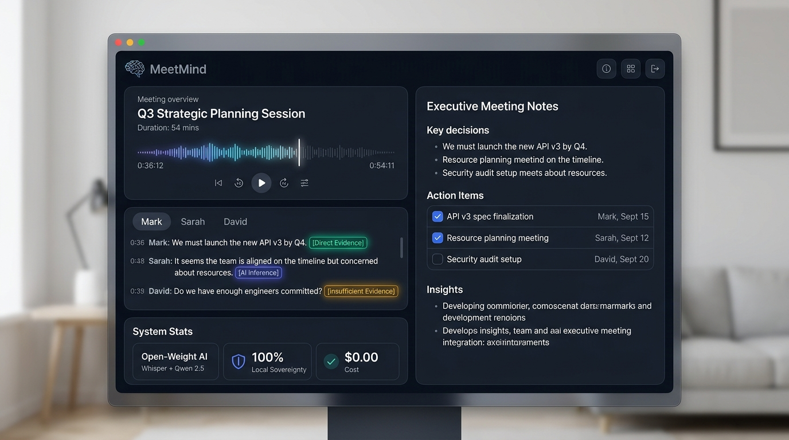
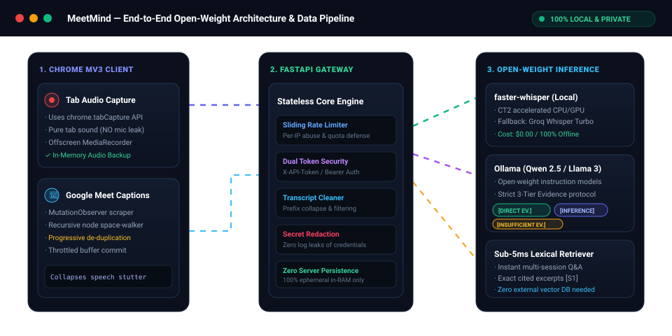

<div align="center">

# 🦥 MeetMind
### The Sloth-Mode Meeting Memory & Interview Coach Powered by Open-Weight AI

[](https://python.org)
[](https://fastapi.tiangolo.com)
[](https://developer.chrome.com/docs/extensions/mv3/)
[](https://ollama.com)
[](https://github.com/SYSTRAN/faster-whisper)
[](https://dev.to/challenges/hacktoberfest-week3-2026-10-19)
[](LICENSE)

<br/>

**Channel your inner sloth. Never take manual meeting notes or stress over interview scorecards again.**

[Explore Features](#-core-engineered-skills) • [Architecture](#-animated-architecture--data-pipeline) • [Quickstart](#-quickstart-guide) • [API Reference](#-api-reference) • [DEV Post](https://dev.to/aashutoshkumarbhardwaj/meetmind-sloth-mode-meeting-memory-interview-coach-powered-by-open-weight-ai-4i0l)

<br/>



</div>

---

## 💡 What is MeetMind?

MeetMind turns browser tab audio recordings or Google Meet captions into an evidence-grounded **Meeting Executive Brief** or **Senior-Level Interview Coaching Review** with zero cloud telemetry.

### The "Slow & Steady" Sloth Payoff:
- 🚫 **No more frantic typing**: Lean back, listen, and let local open-weight models do the synthesis.
- ⏱️ **Save 30–45 mins per meeting**: Instant executive bullet points, explicit decisions, and action item checklists (`- [ ]`) with owners and deadlines.
- 🎯 **Save 1 hour per interview round**: Eliminates scorecard writer's block by extracting exact verbatim candidate statements and evaluating them against senior engineering standards.
- 💰 **$0.00 metered inference cost**: Runs on your laptop using open-weight models (`Qwen 2.5:7b`, `Llama 3.2`, `faster-whisper`).
- 🔒 **100% data sovereignty**: Your private strategy, salary discussions, and NDA-bound client meetings never leave your machine.

---

## ⚡ Animated Architecture & Data Pipeline

MeetMind decouples client-side browser tab capture from the stateless AI engine:

<div align="center">
  
</div>

```
┌─────────────────────────────────┐       ┌─────────────────────────────────┐       ┌─────────────────────────────────┐
│     Chrome MV3 Extension        │       │         FastAPI Gateway         │       │     Open-Weight AI Pipeline     │
│  · tabCapture (pure tab audio)  │ HTTPS │  · Sliding Rate Limiter (DoS)   │ Local │  · faster-whisper (CT2 / GPU)   │
│  · Offscreen MediaRecorder      ├──────►│  · Secret Redaction in logs     ├──────►│  · Ollama (Qwen 2.5 / Llama 3)  │
│  · Meet caption de-duplication  │       │  · Prefix speech normalizer     │       │  · Sub-5ms Lexical Retriever    │
│  · Zero-dependency MD parser    │       │  · Zero server persistence      │       │  · 3-Tier Evidence Classifier   │
└─────────────────────────────────┘       └─────────────────────────────────┘       └─────────────────────────────────┘
```

---

## 🌟 Core Engineered Skills

| # | Skill / Capability | Technical Implementation | Benefit |
|---|---|---|---|
| **1** | **Isolated Tab Audio Capture** | Chrome MV3 Offscreen document + `tabCapture`. Captures the call while completely excluding your background microphone. | Crisp audio, no background keyboard noise. |
| **2** | **Audio Preservation & Recovery** | Preserves raw audio buffers in memory. If transcription fails or drops, retry with 1 click or download `.webm` locally. | Zero lost meetings or audio corruptions. |
| **3** | **Open-Weight AI Core** | Native support for local `faster-whisper` and **Ollama** (`qwen2.5:7b`, `llama3.2`). | **$0.00 cost**, zero cloud vendor lock-in. |
| **4** | **Strict 3-Tier Evidence Protocol** | Prompt engineering forces strict classification:<br>• `[Direct Evidence]` for verbatim quotes<br>• `[AI Inference / Analysis]` for evaluations<br>• `[Insufficient Evidence]` for gaps | **Zero hallucinated commitments or answers.** |
| **5** | **Progressive Caption De-duplication** | Space-aware recursive DOM walker in `content.js` + backend regex collapsing filter eliminates live speech recognition stutter. | Clean LLM context window without duplicate fragments. |
| **6** | **Sub-5ms Cross-Session Intelligence** | In-memory deterministic lexical retriever indexes past transcripts. Ask questions and get answers with cited source blocks (`[S1]`). | No heavy external vector database or API cost. |
| **7** | **Zero-Dependency Markdown Engine** | Built-in client-side parser renders custom glowing status pills, task checkboxes, zebra-striped tables, and 1-click `.md` export. | Fast, secure, and compliant with Chrome MV3 CSP. |

---

## 🚀 Quickstart Guide

### 1. Prerequisites
- **Python 3.10+**
- **Google Chrome** (or any Chromium browser supporting MV3)
- *(Optional for 100% offline mode)*: [Ollama](https://ollama.com/)

---

### 2. Backend Setup

Clone the repository and install dependencies:

```bash
git clone https://github.com/aashutoshkumarbhardwaj/MeetMind.git
cd MeetMind/backend

# Create virtual environment
python3 -m venv .venv
source .venv/bin/activate  # Windows: .venv\Scripts\activate

# Install dependencies
pip install -r requirements.txt
```

#### Choose Your Privacy Mode in `backend/.env`:

```bash
cp .env.example .env
```

#### 🌿 Mode A: 100% Local & Offline (Open-Weight AI)
```env
APP_ENV=development
AI_PROVIDER=ollama
OLLAMA_BASE_URL=http://localhost:11434/v1
OLLAMA_CHAT_MODEL=qwen2.5:7b
TRANSCRIPTION_PROVIDER=local
WHISPER_MODEL=small
WHISPER_DEVICE=cpu
WHISPER_COMPUTE_TYPE=int8
```
> Pull your model via Ollama: `ollama pull qwen2.5:7b`  
> Install local transcription: `pip install -r requirements-local.txt`

#### ⚡ Mode B: Ultra-Fast Cloud (Groq Open-Weights)
```env
APP_ENV=development
AI_PROVIDER=groq
GROQ_API_KEY=gsk_your_groq_api_key_here
ANALYSIS_MODEL=openai/gpt-oss-120b
TRANSCRIPTION_PROVIDER=groq
TRANSCRIPTION_MODEL=whisper-large-v3-turbo
```

Start the backend:
```bash
uvicorn main:app --reload --port 8000
```
Verify health:
```bash
curl http://localhost:8000/health
# {"status":"ok","ai_provider":"ollama","analysis_model":"qwen2.5:7b",...}
```

---

### 3. Chrome Extension Setup

1. Open Chrome and navigate to `chrome://extensions`.
2. Toggle on **Developer mode** in the top-right corner.
3. Click **Load unpacked** and select the `extension/` folder from this repo.
4. Open any Google Meet call or web audio tab.
5. Click the **MeetMind** extension icon:
   - Ensure the Backend service URL points to `http://localhost:8000`.
   - Click **Connect & verify backend**.
   - Click **Start recording** or **Load Meet captions** (or use the instant **Sample** button for quick testing).
   - Click **Generate briefing** to see the structured output!

---

### 4. Interactive Demo Showcase

MeetMind includes a standalone, interactive showcase page designed for demos and presentations:

```bash
# Serve the extension directory
python3 -m http.server 8123 --directory extension
```
Open **`http://localhost:8123/demo.html`** in your browser to interact with the device simulator and review live telemetry.

---

## 📡 API Reference

| Method | Endpoint | Description | Auth Required |
|---|---|---|---|
| `GET` | `/health` | Liveness check, provider status, and model info | No |
| `GET` | `/api/auth-check` | Verifies configured token against server | Yes (if enabled) |
| `POST` | `/api/transcribe` | Multipart `.webm` audio upload $\rightarrow$ transcript | Optional |
| `POST` | `/api/analyze` | Generates meeting brief or interview review | Optional |
| `POST` | `/api/ask` | Cross-session Q&A with cited source excerpts | Optional |

### Sample: Generate Meeting Brief
```bash
curl -X POST http://localhost:8000/api/analyze \
  -H "Content-Type: application/json" \
  -d '{
    "transcript": "Omar: We need to ship onboarding by Friday. Priya will update copy Wednesday. Facilitator: We agreed to remove the profile step for v1.",
    "mode": "meeting"
  }'
```

### Sample: Cross-Session Intelligence (Ask)
```bash
curl -X POST http://localhost:8000/api/ask \
  -H "Content-Type: application/json" \
  -d '{
    "question": "What did the team decide about onboarding?",
    "sessions": [
      {
        "session_id": "session-1",
        "title": "Sprint Planning",
        "transcript": "Omar: We agreed to remove the profile step for v1."
      }
    ]
  }'
```

---

## 🧪 Testing

Run the full automated test suite:

```bash
# Install test requirements
pip install -r backend/requirements-dev.txt

# Run pytest
PYTHONPATH=backend pytest -v backend/tests
```
> **20/20 tests passing in ~0.45s** covering rate limiting, lexical retrieval, prompt construction, authentication tokens, and provider fallback resilience.

---

## 🛡️ Security & Privacy Architecture

- **Tab Isolation**: Audio capture captures browser tab sound only; your ambient microphone is never accessed.
- **Zero Server Retention**: Audio and transcripts are processed strictly in RAM and discarded immediately after response generation.
- **Credential Protection**: Automatic logging filters redact Bearer tokens, API keys, and sensitive authorization headers from server logs.
- **Rate-Limiting**: Built-in sliding window prevents DoS and protects upstream model quotas.

---

## 📄 License & Attribution

Distributed under the **MIT License**. See `LICENSE` for more information.

### Open-Source References:
- [TabScribe](https://github.com/danielsemerjya/tabscribe) (MIT) — Offscreen tab audio architecture reference.
- [TranscripTonic](https://github.com/vivek-nexus/transcriptonic) (MIT) — Google Meet caption fallback pattern.
- [Cognium Meet](https://github.com/cogniumhq/cognium-meet) — Session Q&A architectural reference.

See [THIRD_PARTY_NOTICES.md](THIRD_PARTY_NOTICES.md) for full attribution details.

---

<div align="center">
Built with 🦥 for <b>Hacktoberfest 2026: Slow &amp; Steady</b>.<br/>
<i>Work smarter, rest easier, and let open-weight AI do the heavy lifting.</i>
</div>
